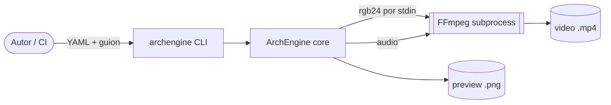
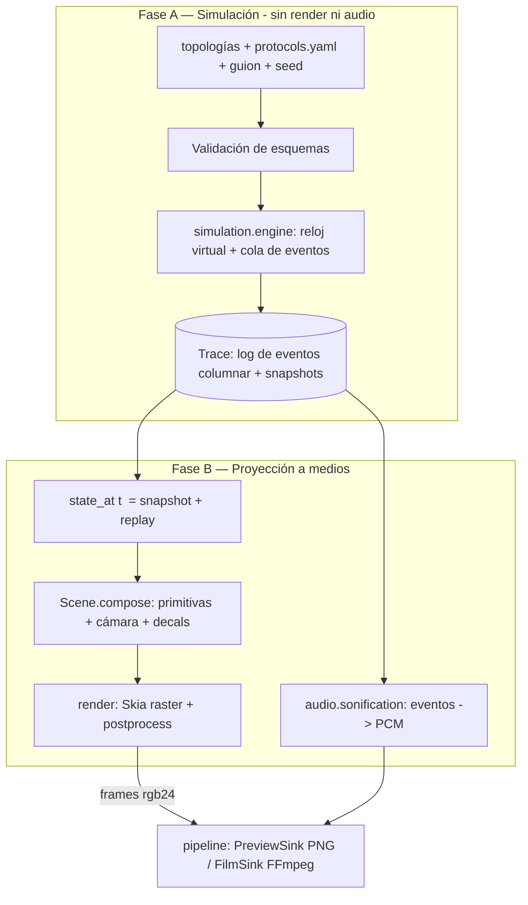
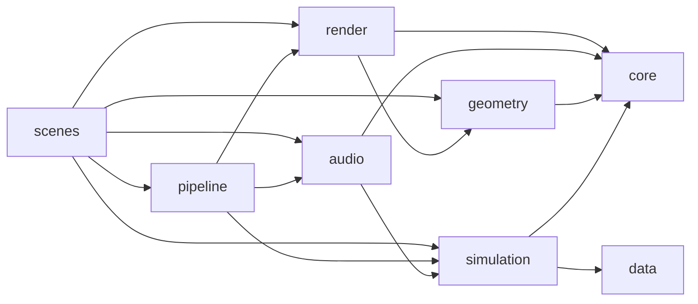
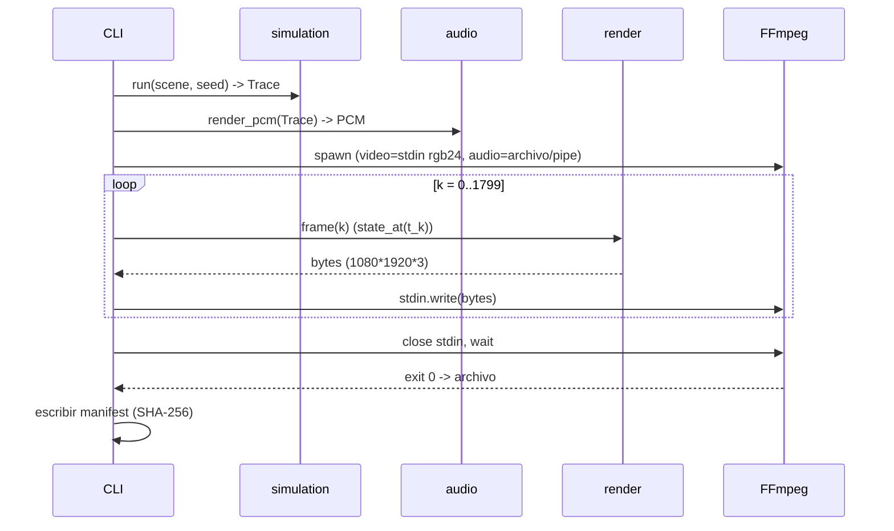
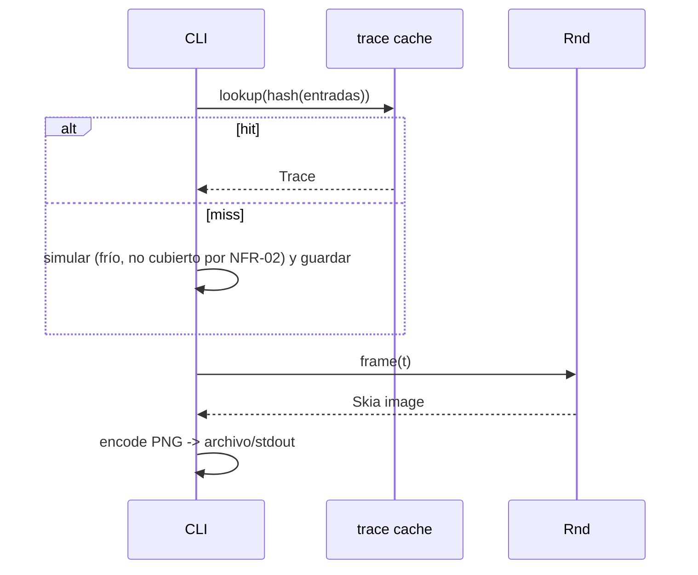

# 01 — Visión general de la arquitectura

Cubre: FR-01…FR-24, NFR-01…NFR-08 a nivel de sistema. Detalles por subsistema en los documentos 02–06.

## 1. Contexto

ArchEngine es una **biblioteca + CLI** sin servicios de red ni base de datos. Entradas: archivos YAML/Python. Salida: PNG (preview) o video (film).



Dependencias externas (PDR cabecera): Python ≥ 3.11, `skia-python`, NumPy, FFmpeg (binario externo, [OQ-23](11-open-questions.md)). Fuente JetBrains Mono empaquetada ([OQ-14](11-open-questions.md)).

## 2. Decisión estructural central

El PDR dice que "el estado visual es un subproducto directo de la simulación" (FR-08) y exige preview de un instante arbitrario `t` (FR-18) y film determinista (NFR-04). Esto se cumple con un diseño de **dos fases** ([ADR-0001](adr/0001-two-phase-simulate-then-render.md)):



Consecuencias: (a) el render es una **función pura** `frame(k) = render(state_at(t_k), camera(t_k), seed, k)`; (b) el audio se calcula **sin** renderizar; (c) el preview sólo paga `state_at` + 1 cuadro; (d) la simulación nunca importa Skia.

## 3. Mapa de módulos

Los paquetes `data/`, `simulation/`, `geometry/`, `render/`, `audio/`, `scenes/` son del PDR §3. Los marcados `[DERIVED]` no están en el árbol del PDR pero son necesarios para implementarlo (CLI, pipeline, tipos comunes).

```text
archengine/
├── data/
│   ├── topologies/*.yaml            # FR-01
│   └── protocols.yaml               # FR-02
├── core/                     [DERIVED]  # sin dependencias internas
│   ├── timebase.py                  # µs enteros, frame<->tiempo (ADR-0002)
│   ├── rng.py                       # substreams PCG64 (ADR-0004)
│   ├── schema.py                    # modelos + validación de YAML (06)
│   └── manifest.py                  # versiones, hashes, seed
├── simulation/
│   ├── engine.py                    # FR-03
│   ├── trace.py              [DERIVED]  # log columnar + snapshots + state_at
│   ├── storage/ (lsm.py, wal.py, btree.py, disk.py)   # FR-05
│   ├── networking/ (channel.py)     # FR-04
│   └── consensus/ (raft.py, paxos.py) # FR-06 (post-MVP)
├── geometry/
│   ├── primitives.py                # FR-13 (+ MemoryBlock [DERIVED])
│   └── topology_layout.py           # FR-14
├── render/
│   ├── core.py                      # FR-09, FR-11, FR-12
│   ├── theme.py                     # FR-10
│   └── postprocess.py               # FR-15
├── audio/
│   └── sonification.py              # FR-16, FR-17
├── pipeline/                 [DERIVED]
│   ├── preview.py                   # FR-18
│   ├── film.py                      # FR-19
│   └── ffmpeg_sink.py
├── cli.py                    [DERIVED]  # FR-18/19 entrada
└── scenes/
    ├── common.py                    # helpers (p. ej. packets_on)
    └── ep01_lsm_vs_btree.py         # FR-21
```

### Regla de dependencias (verificable con `import-linter` en CI)



Prohibido: `simulation → render/audio/geometry/scenes`; `render → simulation` (el render recibe un *view-model* de sólo lectura, no el motor); ningún paquete importa `scenes` ni `cli`. Esto protege el determinismo y permite simular sin dependencias gráficas (NFR-07).

## 4. Responsabilidades

| Componente | Responsabilidad | No hace |
| :--- | :--- | :--- |
| `core.timebase` | Única fuente de conversión cuadro↔µs con aritmética entera. | Leer reloj de pared. |
| `core.rng` | Flujos pseudoaleatorios independientes por componente. | Usar `random` global ni `numpy.random` global. |
| `core.schema` | Parsear y validar YAML (`safe_load`), errores con ruta (`nodes[2].buffer`). | Ejecutar código. |
| `simulation.engine` | Cola de eventos ordenada `(t_us, seq)`, despacho, fallos inyectados. | Conocer colores/geometría. |
| `simulation.trace` | Registrar transiciones; `state_at(t)`. | Mutar estado al consultar. |
| `geometry` | Generar mallas/polígonos 3D y rutas Manhattan. | Rasterizar. |
| `render.core` | Proyección ortográfica, culling, orden por `LAYER`, dibujo Skia, decals. | Decidir *qué* mostrar (eso lo hace la escena). |
| `audio.sonification` | Mapear eventos de la trace a PCM determinista. | Depender del render. |
| `pipeline` | Orquestar preview/film, FFmpeg, manifest. | Lógica de simulación. |
| `scenes` | Guion: segmentos, cámara, overlays, fallos a inyectar. | Reimplementar algoritmos. |

## 5. Flujos críticos

### 5.1 Film



### 5.2 Preview



### 5.3 Fallo de FFmpeg durante film

Si FFmpeg termina con código ≠ 0 o se cierra el pipe (`BrokenPipeError`), el pipeline aborta, captura `stderr`, elimina el archivo parcial y retorna código de salida ≠ 0 (ver [05](05-pipeline-and-cli.md) §6).

## 6. Modelo de concurrencia

Baseline **monoproceso y síncrono** (simplicidad + determinismo). Paralelismo de render es opcional y se decide en [ADR-0008](adr/0008-render-concurrency.md) / OQ-20. La simulación es estrictamente secuencial (determinismo por `(t_us, seq)`).

## 7. Presupuestos y dimensionamiento base

| Magnitud | Valor | Cálculo |
| :--- | :--- | :--- |
| Cuadros del Ep. 01 | 1.800 | 60 s × 30 |
| Bytes por cuadro `rgb24` | 6.220.800 | 1080×1920×3 |
| Flujo total por pipe | ≈ 11,2 GB | 1.800 × 6,22 MB |
| Tiempo film objetivo | ≈ 720 s | 1.800 × 0,40 s |
| PCM 48 kHz estéreo f32 | ≈ 23 MB | 60 × 48.000 × 2 × 4 |

## 8. Decisiones registradas

| ADR | Tema | Estado |
| :--- | :--- | :--- |
| [0001](adr/0001-two-phase-simulate-then-render.md) | Simular → trace → render | Propuesta |
| [0002](adr/0002-time-model.md) | Modelo de tiempo | Propuesta |
| [0003](adr/0003-painters-algorithm-layers.md) | Capas/painter en vez de Z-buffer | Aceptada (PDR) |
| [0004](adr/0004-deterministic-rng.md) | RNG determinista | Propuesta |
| [0005](adr/0005-audio-delivery-to-ffmpeg.md) | Entrega de audio a FFmpeg | Propuesta / OQ-05 |
| [0006](adr/0006-scene-authoring-format.md) | Formato de escenas | Propuesta / OQ-04 |
| [0007](adr/0007-reproducible-encoding.md) | Codificación reproducible | Propuesta / OQ-06 |
| [0008](adr/0008-render-concurrency.md) | Concurrencia de render | Propuesta / OQ-20 |
| [0009](adr/0009-visual-fidelity-at-scale.md) | Fidelidad visual a escala | Propuesta / OQ-18 |
