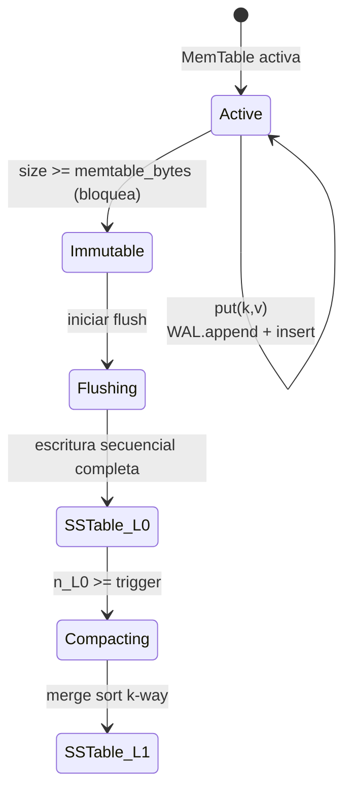

# 02 — Motor de simulación

Cubre FR-03, FR-04, FR-05, FR-06, FR-07, FR-08. Decisiones: [ADR-0001](adr/0001-two-phase-simulate-then-render.md), [ADR-0002](adr/0002-time-model.md), [ADR-0004](adr/0004-deterministic-rng.md), [ADR-0009](adr/0009-visual-fidelity-at-scale.md).

## 1. Principio

> "El estado visual no se anima de manera fija: es el reflejo directo de las transiciones de estado de los algoritmos." (PDR §4.3)

Por tanto toda propiedad visible (color, nivel de llenado, posición de cabezal, puntero head/tail, ocupación de cola) debe existir como **estado de la simulación**. El render no inventa estado; sólo puede **suavizar la cámara y los overlays de UI** `[DERIVED]`, nunca el comportamiento del sistema simulado. Mover un cabezal de disco de un sector a otro en 8 ms es una transición real de la simulación (con su duración de seek), no un tween arbitrario.

## 2. Reloj virtual y cola de eventos

- Unidad: **tick = 1 µs**, entero de 64 bits ([ADR-0002](adr/0002-time-model.md)). Nunca `float` para tiempo.
- Cola de prioridad con clave `(t_us, seq)`; `seq` es un contador monótono global que rompe empates de forma determinista (mismo `t_us` → orden de inserción).
- Bucle:

```python
while queue and queue[0].t_us <= t_end_us:
    ev = heappop(queue)
    clock.now_us = ev.t_us
    target = components[ev.target_id]
    for new_ev in target.handle(ev, ctx):  # ctx: rng del componente, clock, emit()
        heappush(queue, new_ev)  # new_ev.t_us >= now_us (validado)
    trace.record_transition(...)  # si hubo cambio observable
```

- Un componente implementa `handle(event, ctx) -> Iterable[Event]` y `snapshot() -> dict` / `restore(dict)`. No tiene acceso a `time.time()`, ni a otros componentes salvo vía eventos.
- `Δt` regulado del PDR ("ticks discretos regulados Δt"): se ofrecen **dos clases de eventos**: *discretos* (llegada de paquete, fin de I/O) y *ticks periódicos* (`TickEvent` cada `Δt`, p. ej. para telemetría o timers). El valor de `Δt` de telemetría es configurable (provisional: 1 ms) — [OQ-09](11-open-questions.md).

### Tipos base

| Tipo | Campos |
| :--- | :--- |
| `Event` | `t_us: int`, `seq: int`, `target: ComponentId`, `kind: str`, `payload: dict` (sólo tipos JSON) |
| `ComponentId` | `str` estable definida en YAML (p. ej. `node.db1.lsm`) |
| `Transition` | `t_us, component, field, old, new` (registrada en trace) |

## 3. Trace y `state_at(t)`

[`trace.py` `[DERIVED]`] almacena en **arrays NumPy columnares** (`t_us:int64`, `comp:int32`, `kind:int16`, `a:int64`, `b:int64`) para no exceder 1,5 GB (R-04; un objeto Python por evento costaría ~300 B × 10⁶ = 300 MB+).

- **Snapshots** completos de todos los componentes cada `snapshot_interval` (provisional: 1 s virtual).
- `state_at(t)`: localizar el snapshot ≤ t (`np.searchsorted`), `restore`, reaplicar transiciones hasta `t`. Coste O(eventos entre snapshot y t). Para Ep. 01 debe ser ≪ 20 ms `[DERIVED]`.
- La vista devuelta es un **ViewModel inmutable** (`NodeView`, `QueueView`, `DiskView`, …) — el render no toca objetos vivos.
- Caché en disco opcional de la trace, clave `sha256(yaml + protocols + scene + seed + engine_version)` ([OQ-21](11-open-questions.md)).

## 4. Redes (FR-04) — `simulation/networking/channel.py`

`Channel` modela una arista dirigida:

| Parámetro | Fuente | Modelo |
| :--- | :--- | :--- |
| `latency_us` | topología/protocols | base fija |
| `jitter_us` | idem | `latency + U(−j, +j)` con RNG del canal |
| `loss` | idem | Bernoulli por paquete |
| `bandwidth` | `[OPEN QUESTION]` — el PDR no lo menciona | no modelado en MVP |
| Particiones | evento `Partition(a_set, b_set, t_start, t_end)` | descarta todo paquete que cruce |

Cada paquete en vuelo genera eventos `PacketDepart`/`PacketArrive`; la posición entre ambos se **deriva** por `t` (el render puede calcular progreso lineal `(t−t_dep)/(t_arr−t_dep)` a lo largo de la ruta Manhattan: es geometría del transporte, no del algoritmo). Esto es lo que consume `packets_on` (helper de escena).

MVP (Ep. 01): **no requerido** (no hay red en §5). Se implementa la interfaz; implementación completa en post-MVP (R-08).

## 5. Almacenamiento (FR-05) — `simulation/storage/`

### 5.1 Dispositivo de disco `disk.py` `[DERIVED]`

Modelo mínimo para reproducir la narrativa "el cabezal salta buscando bloques" (PDR §5 seg. 2):

- `DiskModel(n_tracks, seek_us(Δtrack), rotational_us, transfer_us_per_page)`.
- El cabezal tiene `track` actual; escribir una página en `track'` cuesta `seek(|track'−track|) + rotational + transfer`. El tiempo transcurre en la simulación, por lo que el *I/O wait* (PDR: "silencios forzados por I/O wait") es observable como intervalos sin avance.
- Escritura secuencial ⇒ `Δtrack = 0/1`: barato. Es la razón física de que LSM gane; **no** se hardcodea el resultado.

Parámetros numéricos (OQ-11 resuelta en [11](11-open-questions.md) y [06](06-data-and-schemas.md) §3): Disco HDD 7200 RPM, latencia rotacional promedio $4166\ \mu\text{s}$, seek promedio $8500\ \mu\text{s}$, seek adyacente $800\ \mu\text{s}$, tasa de transferencia $150\text{ MB/s}$ ($\approx 27.3\ \mu\text{s}$ por página de 4KB). Fuente: Seagate Enterprise HDD Datasheets.

### 5.2 LSM-Tree `lsm.py` + WAL `wal.py`

Estados y transiciones (FR-05, PDR §5 segs. 3–5):



- `put`: `WAL.append(record)` (escritura secuencial, costo de disco) → inserción en MemTable (sólo memoria, O(1) amortizado). Política `wal_sync: batch` (group commit periódico cada 10 ms, alineado con Cassandra `commitlog_sync: periodic` y RocksDB `sync=false` default; OQ-11 resuelta).
- **Flush**: la MemTable activa se congela (`Immutable`, el PDR: "se bloquea"); nueva MemTable activa recibe escrituras; la inmutable se escribe como SSTable inmutable a `disk`.
- **Compaction**: fusión ordenada de SSTables (PDR "Merge Sort"). Se registra `bytes_in`/`bytes_out` para **write amplification** real.
- **Crash** (evento `PowerLoss(t)`): se descarta todo estado volátil (MemTable activa e inmutable sin flush); el WAL en disco persiste. **Recovery** = releer WAL (costo secuencial simulado) y reconstruir MemTable. La "recuperación instantánea" del PDR se *mide* (tiempo de replay), no se asume; si el resultado no es "instantáneo", el guion debe reflejarlo o ajustar el tamaño del WAL (R-05).
- Invariante probado: tras recovery, el conjunto de claves confirmadas por el WAL es idéntico al previo al crash.

### 5.3 B-Tree `btree.py`

- B+Tree con páginas de tamaño fijo, buffer pool limitado, escritura in-place de páginas modificadas (provisional, [OQ-19](11-open-questions.md)). Cada `put` aleatorio toca hoja(s) en posiciones de disco pseudoaleatorias → `seek` grande → amplificación de escritura (página entera por registro pequeño) — otra vez **emergente** del modelo.
- Métricas expuestas: `pages_written`, `bytes_logical`, `write_amp`, `head_track`.

### 5.4 Benchmark de 100.000 escrituras (PDR §5 seg. 1)

Las 100.000 escrituras se simulan **una a una** en cada motor (exactitud de contadores). Con ~10–20 eventos por escritura ⇒ 1–2 × 10⁶ eventos por motor: por eso la trace es columnar (R-03/R-04). La *visualización* está muestreada según [ADR-0009](adr/0009-visual-fidelity-at-scale.md). "Concurrentes": `[OPEN QUESTION]` [OQ-18](11-open-questions.md) — provisional: *N* clientes virtuales (p. ej. 64) emiten escrituras con llegada Poisson sembrada; cada motor las serializa según su modelo.

## 6. Consenso (FR-06) — `simulation/consensus/` (post-MVP)

Interfaz común `ConsensusNode(Component)` con `state ∈ {Follower, Candidate, Leader}`, `term`, `voted_for`, `log`.

Raft según PDR §4.3:
- `election_timeout_us ~ U(150_000, 300_000)` muestreado de `ctx.rng` **cada vez** que se reinicia el timer (estocástico pero determinista por semilla).
- Timer expira sin `Heartbeat` ⇒ `Candidate`, `term += 1`, broadcast `RequestVote`.
- Mayoría de votos ⇒ `Leader`, envía `Heartbeat` cada `heartbeat_interval_us` (PDR no lo define → provisional 50 ms `[DERIVED]`, OQ-12).
- `node.state` es lo que lee el render (FR-08): color de nodo `Leader/Candidate/Follower` ⇒ token de tema. El PDR no asigna colores a estos estados `[OPEN QUESTION]` (OQ-14).
- Paxos: alcance sin especificar en el PDR → OQ-12.

## 7. Inyección de fallos (FR-07)

Fallos son **eventos programados** en el guion de escena o en la topología: `NodeCrash(id, t)`, `NodeRecover(id, t)`, `Partition(...)`, `PowerLoss(t)`, `LatencySpike(edge, factor, t0, t1)`. Se insertan en la cola antes de simular; por tanto son deterministas y forman parte de la trace.

## 8. Determinismo en simulación

Reglas obligatorias (verificadas por tests en [09](09-testing-and-quality.md)):

1. Tiempo entero; sin `time.time()`, `datetime.now()`.
2. RNG sólo vía `core.rng` ([ADR-0004](adr/0004-deterministic-rng.md)).
3. No iterar `set` para decisiones con efecto (usar listas/dicts ordenados; Python ≥ 3.7 preserva inserción).
4. Desempate `(t_us, seq)`.
5. Sin hilos en la simulación.
6. `hash()` de `str` de Python es aleatorio por proceso: prohibido como fuente de orden o semilla (usar `hashlib`).

## 9. API interna (contratos)

```python
class Component(Protocol):
    id: ComponentId

    def handle(self, ev: Event, ctx: Ctx) -> Iterable[Event]: ...
    def snapshot(self) -> dict: ...
    def restore(self, snap: dict) -> None: ...
    def view(self) -> object: ...  # dataclass inmutable para el render


class Simulation:
    def __init__(self, topology: Topology, protocols: Protocols, seed: int): ...
    def schedule(self, ev: Event) -> None: ...
    def run_until(self, t_end_us: int) -> Trace: ...


class Trace:
    def state_at(self, t_us: int) -> WorldView: ...
    def events(self, kinds: Sequence[str] | None = None) -> EventArrays: ...  # para audio
```
