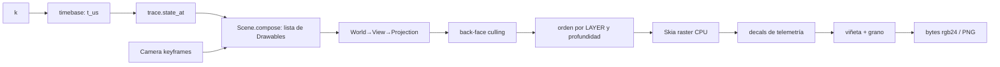

# 03 — Renderizado y geometría

Cubre FR-09…FR-15. Decisiones: [ADR-0003](adr/0003-painters-algorithm-layers.md), [ADR-0008](adr/0008-render-concurrency.md). Presupuesto NFR-01: ≤ 0,40 s por cuadro.

## 1. Tubería de un cuadro



`Scene.compose(view: WorldView, t_us) -> list[Drawable]` es la **única** función que conoce la relación estado→visual (p. ej. `mem_fill = memtable.bytes / capacity`). `render.core` es agnóstico del dominio.

## 2. Superficie Skia y formatos

- Superficie raster CPU (`skia.Surface` N32 premultiplicado, 1080×1920). Sin GPU (NFR-05).
- Conversión a `rgb24` (descartar alfa): `surface.makeImageSnapshot().readPixels(...)` con `ColorType.kRGB_888x`/equivalente a un buffer NumPy preasignado reutilizado por cuadro (evita asignar 6,2 MB × 1.800).
- Antialiasing **activo** y hinting de fuente fijo para reproducibilidad (mismo binario de `skia-python` ⇒ mismos píxeles; se registra la versión en el manifest, [OQ-07](11-open-questions.md)).

## 3. Cámara y proyección (FR-09)

- `orbit_cam(target, azimuth, elevation, distance|scale, roll=0) -> (V, P)`: nombre tomado del PDR (función en `snes-engine`, [OQ-08](11-open-questions.md)). Implementación: matriz de vista 4×4 por *look-at* desde coordenadas esféricas; proyección **ortográfica** ([OQ-15](11-open-questions.md)) → vistas isométricas (p. ej. azimut 45°, elevación ≈ 35,264°) y cenitales (elevación 90°).
- Mundo: sistema diestro, unidades arbitrarias "u" (1 u = 1 px a escala 1 en la vista cenital) `[DERIVED]`.
- Trayectorias: `CameraTrack` = lista de keyframes `(t_us, params)` con interpolación **suavizada** (smoothstep) entre ellos; la cámara sí puede interpolar (no es comportamiento del sistema simulado; FR-08 lo permite, ver [02](02-simulation-engine.md) §1).
- Aritmética en `float64` con NumPy vectorizado (proyectar todos los vértices de la escena en una sola multiplicación matricial).

## 4. Culling y orden (FR-11, [ADR-0003](adr/0003-painters-algorithm-layers.md))

1. **Back-face culling**: para cada cara con normal `n` (precomputada en espacio objeto, rotada con el objeto), descartar si `n · d_view ≥ 0`, con `d_view` dirección de la cámara (constante en proyección ortográfica).
2. **Orden**: clave `(layer:int, depth:float, id:str)` ascendente. `LAYER` es un entero que la primitiva/escena declara (fondo < suelo < bus < cuerpo < LED < decal < HUD); dentro de una capa, se ordena por profundidad del centroide (a más lejos, primero). `id` desempata → determinismo.
3. Limitación conocida: sin Z-buffer no se resuelven intersecciones mutuas entre mallas; las primitivas deben ser **convexas y no interpenetrarse** dentro de una misma capa (regla de composición; validada por tests visuales).

## 5. Decals proyectivos (FR-12)

Mapear un rectángulo de texto/medidor en espacio 2D a un cuadrilátero proyectado de una cara:

```python
m = skia.Matrix()
m.setPolyToPoly(src_quad_4pts, dst_quad_4pts, 4)  # src: rect del decal; dst: cara proyectada
canvas.save()
canvas.concat(m)
draw_decal(canvas)
canvas.restore()
```

- Decal = `DecalSpec(face_ref, renderer)`; `renderer` dibuja en coordenadas planas (p. ej. 256×128). Métricas: `% CPU`, `IOPS`, `QPS` (del `WorldView`), logs (últimas N líneas de eventos de la trace).
- Fuente **JetBrains Mono** empaquetada (OFL) `[DERIVED]`; nunca fuentes del sistema (R-02).
- Cachear el `skia.Typeface` y los `skia.Font` por tamaño. Las líneas de log se dibujan con `TextBlob` cacheado cuando el texto no cambia.

## 6. Tema (FR-10) — `render/theme.py`

Tokens del PDR (hex exactos): `bg #080a0f`, `node_idle #1c2333`, `bus #3b82f6`, `mem #10b981`, `disk #6366f1`, `alert #ef4444`.

`[DERIVED]`/`[OPEN QUESTION]` (OQ-14): tokens adicionales necesarios (texto primario/secundario, LED idle/activo, estados Raft `leader/candidate/follower`, `warn`). Se definen en un único `THEME: Mapping[str, Color]` inmutable y se prohíben literales de color fuera de `theme.py` (lint). **Iluminación sintética**: sombreado Lambert con una luz direccional fija: `shade = ambient + (1−ambient)·max(0, n·L)` aplicado multiplicando el color base por cara; sin sombras proyectadas.

## 7. Primitivas (FR-13) — `geometry/primitives.py`

Toda primitiva implementa:

```python
class Primitive(Protocol):
    id: str
    layer: int
    def faces(self, view) -> list[Face]   # polígonos 3D + normal + color token + decal slots
```

| Primitiva | Forma | Estado visual ← simulación |
| :--- | :--- | :--- |
| `ServerRack` | prisma con `n` módulos blade; ranuras de bus | LED por blade ← actividad/`node.state`; color `node_idle`→`alert` si `Crashed` |
| `CircularQueue` | anillo de `capacity` sectores extruidos | punteros `head`/`tail` ← estado de la cola; sector lleno/vacío; desborde ⇒ `alert` |
| `StorageCylinder` | cilindro facetado (≥ 32 segmentos), sectores, cabezal | cabezal en `track` actual de `DiskModel`; sectores escritos coloreados `disk` |
| `MemoryBlock` `[DERIVED]` | prisma tipo zócalo RAM, llenado en orden secuencial | `memtable.bytes / capacity`; color `mem` |
| `NetworkPipes` | polilíneas ortogonales como segmentos planos/tubos | paquetes (ver [02](02-simulation-engine.md) §4); drop ⇒ `alert` |

Cilindros/anillos se aproximan con polígonos (nº de segmentos fijo) para que el culling analítico y el orden por capas funcionen sin rasterizador 3D.

## 8. Layout Manhattan (FR-14) — `topology_layout.py`

- Entrada: posiciones de nodos en rejilla (provistas en YAML o auto-layout simple por capas) y lista de aristas.
- Algoritmo `[DERIVED]`: ruteo en rejilla con **A\*** sobre celdas libres, costo = longitud + penalización por giro + penalización por cruce; salida: polilínea con sólo segmentos axiales; carriles paralelos por arista compartida (offset fijo) para evitar solapamientos. Empate de rutas resuelto por orden de ID de arista (determinismo).
- La polilínea resultante la consumen `NetworkPipes` (geometría) y `packets_on` (posición de paquetes por longitud de arco).
- Auto-layout de nodos no está especificado por el PDR; MVP: posiciones explícitas en el YAML.

## 9. Post-proceso (FR-15) — `postprocess.py`

| Efecto | Implementación | Determinismo/coste |
| :--- | :--- | :--- |
| Viñeta "matricial" | Máscara de atenuación radial/elíptica precomputada (`float32` H×W) y multiplicación en el buffer `uint8`. "Matricial" se interpreta como **aplicada como máscara matricial**; si implica patrón de puntos/trama es `[OPEN QUESTION]` (OQ-14). | Coste constante; máscara única por ejecución. |
| Grano analógico | Pool de *N* tiles de ruido (p. ej. 8) generado una vez con `core.rng` (substream `grain`); el cuadro `k` usa `tile[hash_int(k) % N]` con desplazamiento pseudoaleatorio derivado de `k`. | Determinista por `k`; evita generar 6,2 M de muestras por cuadro. |

Se aplican en `uint8` tras el raster. Orden: viñeta → grano.

## 10. Presupuesto por cuadro `[DERIVED]` (suma 400 ms)

| Etapa | ms |
| :--- | :---: |
| `state_at` + compose | 25 |
| Proyección + culling + sort (NumPy) | 45 |
| Raster Skia (caras, LEDs, tuberías) | 200 |
| Decals + texto | 50 |
| Post-proceso | 40 |
| Conversión rgb24 + `write` al pipe | 40 |

Se verifica con el benchmark de CI ([08](08-nfr-security-observability-scalability.md) §2). Si R-01 se materializa, palancas en orden: caches de geometría estática (rack/cilindros) en un `Picture`/capa base reutilizable; reducir segmentos; paralelismo por cuadro (ADR-0008).

### Optimización de capa estática

Elementos que no cambian por cuadro (fondo, suelo, carcasas) se rasterizan una vez a un `skia.Image` de fondo por **cámara**; sólo válido mientras la cámara es estática. Con cámara en movimiento se recalcula.
