# 07 — Especificación del Episodio 01 (MVP)

> «LSM-Trees vs B-Trees: ¿Por qué Cassandra escribe tan rápido?» — 9:16, 1080×1920, 60,0 s, 30 FPS = **1.800 cuadros** (FR-21; PDR §5). Los intervalos, acciones visuales y diseño sonoro vienen del PDR; los elementos `[DERIVED]` operacionalizan cada fila en términos de simulación.

## 1. Línea de tiempo

```mermaid
gantt
    title Episodio 01 - 60 s
    dateFormat  X
    axisFormat %ss
    section Segmentos
    Intro & Benchmark     :0, 5
    B-Tree aleatorio      :5, 15
    LSM MemTable          :15, 30
    Flush & Compaction    :30, 45
    Crash & WAL replay    :45, 55
    Conclusión            :55, 60
```

Cuadros por segmento: 150 · 300 · 450 · 450 · 300 · 150 = 1.800 ✔.

## 2. Matriz segmento → simulación → visual → audio

| Seg. | Intervalo | Eventos de simulación (causa) | Estado visual (efecto) | Audio (`SoundMap`) |
| :--- | :---: | :--- | :--- | :--- |
| 1 Intro & Benchmark | 0–5 s | Arranca `workload` de 100.000 escrituras hacia ambos motores (OQ-18). | Consola de carga con contador y tasa (decal); ambos sistemas visibles `[DERIVED]`. | `bench.tick`: clicks rítmicos acelerando (densidad ∝ tasa). |
| 2 B-Tree | 5–15 s | `btree.put` aleatorio ⇒ `disk.seek` de gran distancia; I/O wait; `write_amp` alto. | `StorageCylinder`: cabezal salta erráticamente; contador de amplificación de escritura. | Tono grave saturado e irregular; silencios donde `disk.busy`. |
| 3 LSM (MemTable) | 15–30 s | `lsm.put`: `wal.append` + insert en MemTable. | `MemoryBlock` verde (`mem`) llenándose secuencial. | Arpegio limpio y constante + zumbido de clúster estable. |
| 4 Flush & Compaction | 30–45 s | MemTable → `Immutable` (bloqueada) → `flush` → SSTable inmutable → `compaction` (merge k-way). | Bloque congelado que se transfiere a `disk`; fusión 3D de capas (merge sort). | Tono armónico descendente; barrido de filtro resonante. |
| 5 Crash | 45–55 s | `PowerLoss` en LSM; estado volátil perdido; `wal.replay` reconstruye MemTable. | Apagón visual (osciladores/nodos a `alert`), luego reconstrucción desde WAL. | Ruido blanco súbito, corte de osciladores, pulso de reinicio. |
| 6 Conclusión | 55–60 s | Sin eventos nuevos; se congelan métricas finales. | Cuadro comparativo: velocidad de escritura vs. amplificación de lectura. | Acorde de resolución con fade out. |

## 3. Requisitos y aclaraciones del episodio

1. **Métricas del cuadro comparativo**: "velocidad de escritura vs. amplificación de lectura" (PDR). La simulación debe producir **ambas** métricas. El PDR sólo define amplificación de escritura en seg. 2 y "amplificación de lectura" en seg. 6; por tanto el modelo LSM debe exponer `read_amp` (nº de SSTables consultadas por lectura) y el guion debe ejecutar un mini-benchmark de lecturas `[DERIVED]`, o la comparación se limita a los datos disponibles `[OPEN QUESTION]` → OQ-19.
2. **Sincronía**: el guion fija *cuándo* se dispara cada acción (`t` de video); el estado emerge de la simulación. Los eventos que dependen del modelo (momento del primer flush) pueden caer desplazados respecto a las fronteras de segmento; se ajusta con parámetros de motor (`memtable_bytes`, tasa de escritura), **no** con *hardcode* de visual. Test: "el primer `flush.start` ocurre dentro de [30 s, 45 s)".
3. **Alineación de fronteras**: los segmentos en 5/15/30/45/55 s son múltiplos exactos de 1/30 s (150, 450, 900, 1350, 1650) — sin redondeo.
4. **Tiempo de simulación vs. video**: el benchmark de 100.000 escrituras a ritmo real tardaría menos (LSM) o más (B-Tree) que la ventana de 5–15 s; por eso `time_scale` por segmento ([ADR-0002](adr/0002-time-model.md), OQ-09) es necesario para que el B-Tree se vea "errático y lento" y el LSM "fluya" sin contradecir el modelo: se cambia la *velocidad de reproducción*, nunca los costos.
5. **Crash**: "Demostración de recuperación instantánea" (PDR) se valida como propiedad medible: tiempo de `wal.replay` ≪ duración del segmento. Si el modelo da otro valor, se informa (R-05).
6. **Audio**: duración exacta 60,000 s; el último cuadro y la última muestra coinciden (2.880.000 muestras/canal @ 48 kHz).
7. **Idioma de textos**: ES `[DERIVED]` (OQ-14).

## 4. Aceptación del episodio

| Criterio | Verificación |
| :--- | :--- |
| 1.800 cuadros, 1080×1920, 30 FPS, duración 60,0 s ± 1 cuadro en contenedor | `ffprobe` en test de integración |
| Cada fila de §2 tiene eventos de trace con los `kind` indicados en su intervalo | test sobre `trace.events` |
| Tiempo por cuadro p95 ≤ 0,40 s; RAM pico ≤ 1,5 GB | benchmark en runner de referencia (OQ-01) |
| Hash estable en dos ejecuciones consecutivas | test de determinismo (NFR-04) |
| Revisión humana de corrección técnica del guion | checklist de R-05 |

## 5. Implementación (estado final)

Decisiones que operativizan las aclaraciones de §3 (código en `scenes/ep01_lsm_vs_btree.py`):

| Tema | Decisión | Por qué |
| :--- | :--- | :--- |
| Mundos de simulación | LSM y B-Tree se simulan en **dos relojes virtuales independientes** con la misma carga (OQ-18: 50.000 escrituras/s, llegadas Poisson sembradas) | Cada motor serializa según su modelo; el B-Tree tarda ~3.360 s simulados y el LSM ~15 s |
| Registro | 512 B por escritura | Da amplificación de escritura B-Tree ≈ 4096/512 = 8× y un memtable de 64 MiB que se llena a las 131.072 escrituras |
| Carga del LSM | 560.000 escrituras (100.000 del benchmark + carga sostenida) | 4 flushes ⇒ L0 alcanza el disparador (4) y ocurre la compactación L0→L1 |
| B-Tree | *Upsert* aleatorio sobre una tabla ya cargada (1 M de hojas de 4 KiB, raíz + nivel 1 + hojas, pool LRU de 1.024 páginas) | Seeks largos y reescritura de página entera emergen del disco y del pool |
| `time_scale` | `TimeMap` lineal por tramos (enteros) por motor: el LSM se pausa en el tramo B-Tree; el B-Tree se congela tras el seg. 2 | Solo cambia la velocidad de reproducción (OQ-09) |
| PowerLoss | Programado a los 15 s simulados (tras la compactación); test lo verifica | Los fallos son eventos pre-programados (docs/02 §7) |
| Política WAL | `batch`: *group commit* cada 10 ms; el PowerLoss pierde la cola no sincronizada (se registra en `power.loss.b`) | Semántica real de Cassandra `commitlog_sync: periodic` |
| Recuperación | Medida: 164 ms para 35.712 registros, ≪ segmento de 10 s (R-05) | Test `test_recovery_is_fast_relative_to_the_segment` |
| Amplificación de lectura | LSM: SSTables consultadas (pico 5 con L0 = 4); B-Tree: páginas leídas por operación (1,9) | OQ-19: ambas salen de la simulación |
| Audio | `disk.seek` agrupado por ventanas de 20 ms (tono grave; ventanas dominadas por seeks largos = silencio por I/O wait); `memtable.put` ⇒ arpegio por ventanas de 62,5 ms | Densidad de 10⁵ eventos agrupada (docs/04 §4) |
